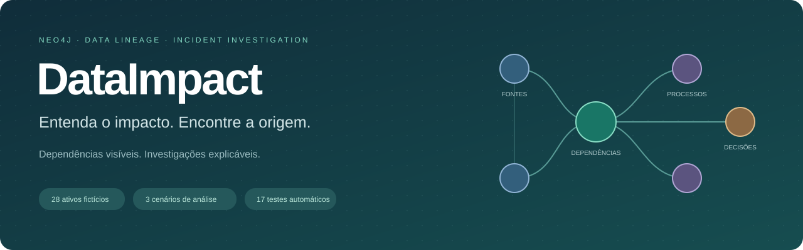
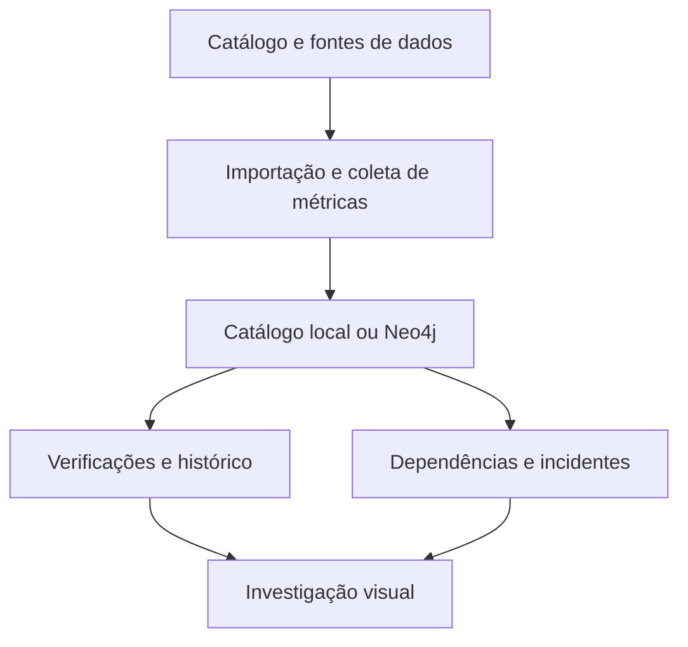

<p align="center">
  
</p>

<p align="center">
  <a href="https://github.com/alegarcinascimento/dataimpact/actions/workflows/ci.yml"></a>
  
  
  <a href="LICENSE"></a>
</p>

<p align="center"><strong>Identifique problemas nas bases. Rastreie os consumidores. Investigue com evidências.</strong></p>

<p align="center">
  <a href="#comece-em-poucos-minutos">Começar</a> ·
  <a href="#conecte-seus-dados">Conectar dados</a> ·
  <a href="#arquitetura">Arquitetura</a> ·
  <a href="#resultados-e-métricas">Resultados</a> ·
  <a href="#documentação-técnica">Documentação</a>
</p>

## O que é o DataImpact

O DataImpact é um projeto de código aberto para monitorar regras de qualidade e investigar dependências entre fontes, processos, tabelas e relatórios. Quando uma base apresenta atraso ou volume insuficiente, a ferramenta mostra a evidência da violação e os consumidores potencialmente afetados.

O histórico de verificações permite acompanhar abertura e resolução dos alertas. A recuperação de incidentes anteriores complementa a investigação com ocorrências e procedimentos registrados. O objetivo é apoiar equipes de engenharia de dados, analytics e governança na compreensão do problema e na coordenação da resposta.

> **Se esta base apresentar um problema, quais entregas dependem dela e por qual caminho?**

## O que você pode fazer

| Recurso | Aplicação |
| --- | --- |
| Verificações de qualidade | Identificar violações de volume mínimo e atualização máxima |
| Dependências direcionadas | Rastrear consumidores a jusante e fontes a montante |
| Caminhos explicáveis | Conferir um caminho mínimo em número de relações para cada ativo alcançado |
| Responsabilidade | Consultar as equipes associadas aos ativos no alcance |
| Histórico | Registrar verificações e transições de abertura e resolução |
| Dados próprios | Importar catálogo JSON/CSV, medir arquivos CSV e coletar objetos PostgreSQL selecionados |
| Persistência Neo4j | Armazenar ativos, relações, incidentes, execuções e achados |
| Recuperação de incidentes | Consultar ocorrências por palavras ou embeddings, conforme configuração |
| Exportação | Salvar uma análise de impacto em JSON |
| Laboratório experimental | Comparar recuperação por palavras, contexto do grafo e representações vetoriais |

A ferramenta aponta violações das regras configuradas. Ela não confirma automaticamente a causa raiz, a falha de cada consumidor ou a qualidade de dimensões não monitoradas.

## Comece em poucos minutos

### Explore sem instalar

[Baixe o projeto](https://github.com/alegarcinascimento/dataimpact/archive/refs/heads/main.zip), extraia e abra **DataImpact_Demo.html** no navegador. A demonstração contém dados fictícios e funciona sem banco ou chave de API. A capa deste README é uma ilustração vetorial do fluxo, não uma captura da interface.

1. Clique em **Base saudável → Introduzir falha → Confirmar recuperação**.
2. Abra um alerta para rastrear os consumidores e os caminhos de impacto.
3. Consulte o histórico e compare as buscas no **Laboratório de recuperação**.

As etapas fictícias são registradas no armazenamento local do navegador. Não alteram uma base externa.

### Execute com a API local

Requer Node.js 22 ou superior.

```bash
git clone https://github.com/alegarcinascimento/dataimpact.git
cd dataimpact
npm ci
npm run dev
```

Abra **http://localhost:3000**. Sem configuração adicional, o servidor inicia em modo demonstração.

## Conecte seus dados

O catálogo descreve os ativos e suas dependências. Os registros de negócio permanecem na origem; os coletores persistem metadados e métricas agregadas.

| Entrada | O que oferece |
| --- | --- |
| JSON | Ativos, dependências, regras, métricas e incidentes |
| CSV de catálogo | Ativos e relações em `assets.csv` e `dependencies.csv` |
| CSV de dados | Contagem de registros e maior timestamp da coluna selecionada |
| PostgreSQL | Contagem, atualização e dependências de views entre objetos selecionados |

### Exemplo reproduzível com CSV

```bash
npm run import:catalog -- --input examples/catalog.json --validate
npm run import:catalog -- --input examples/catalog.json
npm run profile:csv -- --file examples/orders.csv --asset orders --timestamp updated_at
```

Copie `.env.example` para `.env` e configure:

```dotenv
DATA_MODE=file
GRAPH_FILE=.data/catalog.json
```

Execute `npm run dev`. O exemplo contém dois registros para uma regra mínima de três, com timestamps antigos. A interface deve mostrar baixo volume e atraso, ligados ao caminho até o relatório consumidor.

### Coleta PostgreSQL

Configure `SOURCE_DATABASE_URL` no ambiente e adapte os objetos e regras em `examples/postgres.json`:

```bash
npm run collect:postgres -- --config examples/postgres.json
```

O coletor executa uma transação somente leitura, com seleção explícita de objetos. A descoberta cobre dependências de views registradas no PostgreSQL; pipelines externos e ferramentas de BI precisam de metadados adicionais. Contagens exatas podem ser custosas em tabelas grandes.

### Persistência e histórico no Neo4j

Configure `NEO4J_URI`, `NEO4J_USERNAME`, `NEO4J_PASSWORD` e `NEO4J_DATABASE` no `.env`. Importe seu catálogo:

```bash
npm run import:catalog -- --input .data/catalog.json --target neo4j
```

Defina `DATA_MODE=neo4j` e reinicie o servidor. Para carregar exclusivamente o conjunto fictício em um banco de desenvolvimento, use `npm run seed`.

Depois de cada coleta, execute:

```bash
npm run monitor
```

O comando registra a verificação em arquivo no modo `file` ou no Neo4j no modo `neo4j`. A coleta e a verificação não são agendadas automaticamente. Detalhes de contratos, permissões e limites estão em [conexão de dados](docs/DATA_SOURCES.md) e [monitoramento](docs/MONITORING.md).

## Arquitetura



A interface usa HTML, CSS, JavaScript e SVG. A API Node.js consulta o catálogo e o Neo4j pelo driver oficial. Os comandos administrativos de coleta e importação são separados da API pública de leitura.

### Modelo do grafo

| Relação | Significado |
| --- | --- |
| `DIAsset → FEEDS → DIAsset` | Um ativo fornece dados para outro |
| `DIIncident → OCCURRED_ON → DIAsset` | Uma ocorrência histórica está ligada a um ativo |
| `DIRun → CHECKED → DIAsset` | Uma execução verificou um ativo |
| `DIRun → HAS_FINDING → DIFinding` | Uma execução registrou um achado |
| `DIFinding → AFFECTS → DIAsset` | Um achado aponta para o ativo de origem |

Ativos possuem identidade, categoria, descrição e equipe responsável. Constraints e `MERGE` suportam a carga repetida do mesmo catálogo sem duplicação. A importação não remove automaticamente elementos ausentes de uma carga posterior.

**Travessia atual:** o navegador calcula o alcance sobre o grafo carregado; o Neo4j persiste o contexto e o histórico e oferece busca vetorial opcional. As consultas do [laboratório Cypher](docs/CYPHER.md) permitem explorar o mesmo domínio no banco. Expansão seletiva no servidor é uma evolução necessária para catálogos maiores.

## Uma demonstração verificável

O catálogo fictício contém 28 ativos e 28 relações `FEEDS`. Há quatro incidentes históricos separados dos 24 incidentes do laboratório de avaliação.

| Origem | Consumidores alcançados | Relatórios no alcance | Equipes envolvidas |
| --- | ---: | ---: | ---: |
| `raw.vendas` | 13 | 5 | 7 |
| `raw.clientes` | 11 | 5 | 7 |
| `raw.lancamentos` | 7 | 3 | 4 |
| `raw.entregas` | 3 | 1 | 2 |

As contagens excluem o ativo selecionado e removem repetições. O painel de fornecedores permanece fora do alcance da origem de vendas, oferecendo um caso de controle para verificar a propagação.

## Resultados e métricas

O laboratório usa **24 ocorrências fictícias e oito perguntas com gabarito manual**. O relatório completo registra resultados por consulta e condições de execução.

| Método | Cobertura nos três primeiros (Recall@3) | Qualidade da ordem (NDCG@3) |
| --- | ---: | ---: |
| Busca por palavras | 85,4% | 0,875 |
| Palavras com contexto do grafo | 95,8% | 0,943 |

**Recall@3** indica quanto das ocorrências relevantes apareceu nas três primeiras sugestões. Se três ocorrências deveriam ser encontradas e duas aparecem, a cobertura é 66,7%.

**NDCG@3** indica se as ocorrências relevantes ficaram nas melhores posições. Varia de 0 a 1; valores maiores representam uma ordenação mais próxima do gabarito ideal.

Esses resultados são médias sobre um conjunto sintético pequeno, elaborado manualmente. Não demonstram redução de incidentes, economia financeira ou acurácia de diagnóstico. O contexto também acrescenta processamento; não há evidência de redução de latência ponta a ponta.

```bash
npm run evaluate
```

[Relatório JSON](public/retrieval-report.json) · [Metodologia](docs/RETRIEVAL_EXPERIMENT.md) · [Exemplos das métricas](docs/METRICS.md)

### Embeddings e Semantic IDs

A busca operacional suporta embeddings no Neo4j quando provedor e índice estão configurados. Separadamente, o laboratório implementa quantização residual com k-means para experimentar códigos semânticos e comparar vetores originais com suas reconstruções.

```bash
# Requer OPENAI_API_KEY; pode gerar cobrança pelo provedor.
npm run evaluate -- --embed
```

A execução publicada não avaliou os métodos com embeddings ou Semantic IDs. O código experimental não contém RQ-VAE, Transformer ou recomendador generativo. Códigos podem colidir e não substituem o ID estável de um incidente.

## Qualidade e operação

```bash
npm test
```

São **24 testes automatizados**, cobrindo regras, integridade de catálogo, ciclos, coleta CSV, protocolo PostgreSQL simulado, API, histórico, recuperação, quantização e o fluxo do HTML autônomo em DOM simulado. A [pipeline de testes](https://github.com/alegarcinascimento/dataimpact/actions/workflows/ci.yml) registra o resultado de cada alteração.

As integrações PostgreSQL, Neo4j e provedor de embeddings ainda precisam de validação conjunta em instâncias reais. Os testes de DOM não substituem revisão visual em navegador.

| Aspecto | Condição atual |
| --- | --- |
| Escala do catálogo | Até 500 ativos, 2.000 dependências e 200 incidentes; sem benchmark de capacidade |
| Arquivos de entrada | Até 10 MiB por arquivo, com leitura em memória |
| Regras | Volume e atualização; sem detecção estatística de anomalias |
| Segurança | API de leitura sem autenticação ou rate limit; exige proteção antes de expor dados internos |
| Escrita | Importação e monitoramento por comandos administrativos |
| Orquestração | Execuções manuais ou integradas ao orquestrador do operador |

## Documentação técnica

| Guia | Conteúdo |
| --- | --- |
| [Instalação](docs/INSTALLATION.md) | Configuração, variáveis e diagnóstico |
| [Conectar dados](docs/DATA_SOURCES.md) | JSON, CSV, PostgreSQL e regras |
| [Arquitetura](docs/ARCHITECTURE.md) | Modelo, contratos e decisões |
| [Cypher](docs/CYPHER.md) | Consultas e resultados esperados |
| [Monitoramento](docs/MONITORING.md) | Histórico e transições |
| [Recuperação](docs/RETRIEVAL_EXPERIMENT.md) | Experimentos e limites |
| [Validação](docs/VALIDATION.md) | Evidências e critérios técnicos |
| [Contribuição](CONTRIBUTING.md) | Como propor e validar melhorias |

## Contribua

Sugestões, reproduções e melhorias são bem-vindas. Abra uma [issue](https://github.com/alegarcinascimento/dataimpact/issues/new) com o caso, o resultado observado e o comportamento esperado. Novos conectores, testes de integração e expansão seletiva em Cypher são áreas úteis para contribuição.

Se o projeto for útil para você, considere deixar uma estrela para facilitar sua descoberta por outras equipes.

[Licença MIT](LICENSE). Os exemplos são fictícios; catálogos próprios devem usar dados autorizados. Projeto independente de código aberto.
