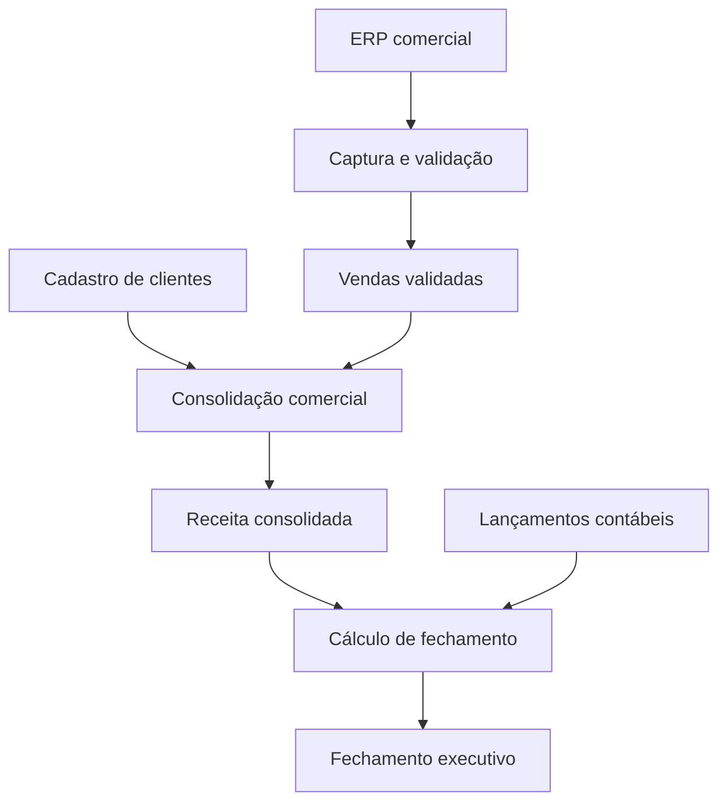

<p align="center">
  
</p>

<p align="center">
  <a href="https://github.com/alegarcinascimento/dataimpact/actions/workflows/ci.yml"></a>
  
  
  <a href="LICENSE"></a>
</p>

<p align="center"><strong>Uma aplicação de engenharia de dados que transforma relações de dependência em caminhos de investigação.</strong></p>

<p align="center">
  <a href="#experimente">Experimente</a> ·
  <a href="docs/ARCHITECTURE.md">Arquitetura</a> ·
  <a href="docs/CYPHER.md">Laboratório Cypher</a> ·
  <a href="docs/MENTOR_REVIEW.md">Guia para mentores</a> ·
  <a href="docs/INSTALLATION.md">Instalação e deploy</a>
</p>

## A pergunta que move o projeto

> **Se esta fonte de dados parar agora, quais processos, relatórios e equipes podem ser afetados — e por qual caminho?**

Um fechamento incompleto aparece no painel executivo. A origem pode estar várias transformações antes: uma captura parcial, um cadastro atrasado ou lançamentos inconsistentes. A investigação exige percorrer dependências, localizar responsáveis e consultar o histórico.

O DataImpact organiza esse contexto em um grafo navegável. Cada resultado de alcance pode ser explicado por um caminho entre ativos. O usuário explora as consequências potenciais de uma indisponibilidade e consulta incidentes anteriores para orientar a investigação.

**Público:** engenharia de dados, analytics engineering, governança e responsáveis por produtos de dados. A hipótese de valor é reduzir o trabalho manual de descobrir dependências e coordenar uma investigação; esse benefício ainda não foi medido em ambiente real.

## O que você encontra aqui

| Capacidade | Comportamento demonstrável |
| --- | --- |
| Análise de impacto | Descobre consumidores diretos e indiretos de um ativo |
| Rastreamento de origem | Percorre as dependências até as fontes |
| Explicabilidade | Mostra um caminho mínimo em número de relações para cada ativo alcançado |
| Simulação | Destaca o alcance potencial de uma indisponibilidade sem alterar processos |
| Contexto operacional | Identifica as equipes responsáveis pelos ativos alcançados |
| Memória de incidentes | Exibe ocorrência, evidência e solução histórica |
| Busca semântica opcional | Recupera incidentes por embeddings armazenados no Neo4j |
| Exportação | Gera JSON com ativo, direção, caminhos e identificação do modo de dados |

**Conjunto demonstrativo:** 28 ativos, 28 relações `FEEDS` e 4 incidentes fictícios. No Neo4j, a carga também cria 4 relações `OCCURRED_ON`, totalizando 32 nós e 32 relações. A visualização principal apresenta somente os ativos e as 28 relações de fluxo.

## Experimente

### Sem instalar nada

[Baixe o projeto](https://github.com/alegarcinascimento/dataimpact/archive/refs/heads/main.zip), extraia e abra **`DataImpact_Demo.html`** no navegador. O arquivo contém interface e dados; a busca é lexical. As fontes externas são opcionais.

O GitHub exibe o código do HTML; para interagir, baixe e abra o arquivo. A capa acima é uma ilustração editorial, não uma captura da interface.

### Com a API local

```bash
git clone https://github.com/alegarcinascimento/dataimpact.git
cd dataimpact
npm ci
npm run dev
```

Abra **http://localhost:3000**. Sem `.env`, a aplicação inicia no modo demonstração. Requer Node.js 22 ou superior.

### Com Neo4j

```bash
cp .env.example .env
# Preencha NEO4J_URI, NEO4J_USERNAME, NEO4J_PASSWORD e NEO4J_DATABASE.
npm run seed
# Defina DATA_MODE=neo4j no .env.
npm run dev
```

O indicador **“Neo4j conectado”** identifica o modo real. Configuração, compatibilidade, embeddings e Vercel estão no [guia de instalação](docs/INSTALLATION.md).

## Uma demonstração com respostas verificáveis

| Ponto de partida | Ativos dependentes | Relatórios alcançados | Equipes envolvidas |
| --- | ---: | ---: | ---: |
| `raw.vendas` | 13 | 5 | 7 |
| `raw.clientes` | 11 | 5 | 7 |
| `raw.lancamentos` | 7 | 3 | 4 |
| `raw.entregas` | 3 | 1 | 2 |

As contagens excluem o ativo selecionado e removem repetições. Dependência significa possibilidade de impacto; não confirma que o consumidor falhou.

**Experimento de dois minutos:**

1. Escolha **Fechamento incompleto**. Veja os cinco relatórios alcançados pela carga de vendas.
2. Confira o caminho até **Fechamento executivo** e as equipes associadas.
3. Observe que **Painel de fornecedores** permanece fora do alcance.
4. Selecione **Fechamento executivo** e alterne para **Origem a montante**: ERP, CRM e sistema contábil participam do resultado.
5. Pesquise **“fechamento com valores menores”** e consulte a evidência da ocorrência histórica.

O [guia para mentores](docs/MENTOR_REVIEW.md) detalha resultados esperados, testes e perguntas de avaliação.

## Por que um grafo?

O problema central é uma rede de dependências com profundidade variável e caminhos compartilhados. Uma fonte pode alimentar vários relatórios; um relatório pode depender de várias fontes. A direção das relações determina a diferença entre investigar a origem e avaliar as consequências.

O Neo4j permite persistir essas relações explicitamente e expressar a exploração de caminhos em Cypher. Uma implementação relacional com consultas recursivas também é possível. A escolha pelo grafo favorece a correspondência entre o domínio, a consulta e a explicação apresentada ao usuário; o projeto não afirma superioridade de desempenho sem benchmark.



*Visão resumida de um trecho do domínio; algumas etapas do conjunto de dados foram agrupadas para facilitar a leitura.*

## Onde o Neo4j participa

| Componente | Papel no projeto | Implementação |
| --- | --- | --- |
| Property graph | Persiste ativos, incidentes e relações | [`scripts/seed.js`](scripts/seed.js) |
| Constraints e `MERGE` | Identidade e carga repetível sem duplicação do mesmo conjunto | [`scripts/seed.js`](scripts/seed.js) |
| Driver oficial | Consulta parametrizada, banco explícito e acesso de leitura | [`lib/db.js`](lib/db.js) |
| Índice vetorial | Recuperação de incidentes por similaridade de embeddings | [`scripts/embeddings.js`](scripts/embeddings.js) |
| Consulta vetorial | Recebe embedding da pergunta e retorna até quatro ocorrências | [`api/search.js`](api/search.js) |
| Travessia visual | Calcula alcance e um caminho por ativo no navegador | [`public/graph.js`](public/graph.js) |

**Decisão arquitetural explícita:** nesta versão, o Neo4j fornece o grafo e o navegador executa a travessia. O [laboratório Cypher](docs/CYPHER.md) apresenta consultas equivalentes para exploração no banco; elas não são chamadas pela interface atual. A evolução para catálogos maiores é mover a expansão para a API e devolver apenas o subgrafo solicitado.

## Embeddings com propósito

A busca de incidentes complementa a exploração de dependências. Com Neo4j e o provedor configurados, a pergunta é convertida em embedding e comparada aos vetores dos incidentes.

| Configuração | Recuperação | Identificação na interface |
| --- | --- | --- |
| Demonstração | Correspondência de palavras | Busca por palavras |
| Neo4j sem chave de embeddings | Correspondência de palavras sobre incidentes do banco | Busca por palavras |
| Neo4j com chave e índice populado | Similaridade vetorial | Busca semântica por embeddings |

A solução não gera respostas com LLM e não implementa GraphRAG completo. Similaridade textual e topologia são exploradas em etapas separadas; reranking por proximidade no grafo faz parte do roadmap. A [arquitetura](docs/ARCHITECTURE.md) explica o fluxo, as decisões e os limites.

## Qualidade e evidências

```bash
npm test
```

A suíte contém **8 testes automatizados**, incluindo resultados esperados por cenário, proteção contra ciclos, integridade do conjunto, API HTTP e interações da interface em DOM simulado. A [pipeline do GitHub Actions](https://github.com/alegarcinascimento/dataimpact/actions/workflows/ci.yml) apresenta o resultado de cada execução.

Não há benchmark de desempenho nem avaliação de recuperação semântica publicados. A validação integrada de Neo4j, provedor de embeddings e deploy precisa ser executada na instância utilizada. Testes de DOM não comprovam o layout visual em navegador.

## Decisões, limites e evolução

| Hoje | Próxima evolução proposta | Critério de conclusão |
| --- | --- | --- |
| Dependências cadastradas por ativo | Linhagem por coluna e ingestão de metadados | Importar um fluxo real anonimizado e validar relações |
| Grafo pequeno carregado na interface | Expansão no servidor e orçamento de travessia | Comparar respostas e medir latência em conjuntos maiores |
| Busca vetorial independente da topologia | Reranking de incidentes por conexão com o ativo | Comparar Recall@k e relevância com baseline lexical |
| Equipe como propriedade | Equipes como nós quando o caso justificar | Consultar responsabilidades compartilhadas sem duplicação |
| API pública com dados fictícios | Controle de acesso e limitação de uso | Testes de autorização e limites antes de dados internos |

O escopo atual é um **MVP de portfólio com integração Neo4j implementada**, ainda sem validação externa documentada. Não há previsão de prejuízo, detecção automática de anomalias, causalidade confirmada ou integração AWS nesta versão.

## Documentação

| Leitura | O que você vai encontrar |
| --- | --- |
| [Arquitetura e modelo](docs/ARCHITECTURE.md) | Schema, contratos, modos, decisões e escalabilidade |
| [Laboratório Cypher](docs/CYPHER.md) | Consultas de exploração, resultados esperados e cuidados |
| [Guia para mentores](docs/MENTOR_REVIEW.md) | Demonstração, evidências, avaliação e perguntas técnicas |
| [Instalação e deploy](docs/INSTALLATION.md) | Execução local, Neo4j, embeddings, Vercel e diagnóstico |
| [Contribuição](CONTRIBUTING.md) | Como propor melhorias com resultados reproduzíveis |

## Referências e autoria

[Neo4j JavaScript Driver](https://neo4j.com/docs/javascript-manual/current/) · [Cypher](https://neo4j.com/docs/cypher-manual/current/) · [Índices vetoriais](https://neo4j.com/docs/cypher-manual/current/indexes/search-indexes/vector-indexes/) · [Vercel Functions](https://vercel.com/docs/functions/runtimes/node-js)

Desenvolvido no contexto de um portfólio de engenharia de dados, com apoio de IA na implementação e documentação. O repositório concentra código, decisões e testes para revisão e reprodução pela comunidade.

[Licença MIT](LICENSE). Dados inteiramente fictícios. Projeto independente, sem vínculo ou endosso oficial da Neo4j.
