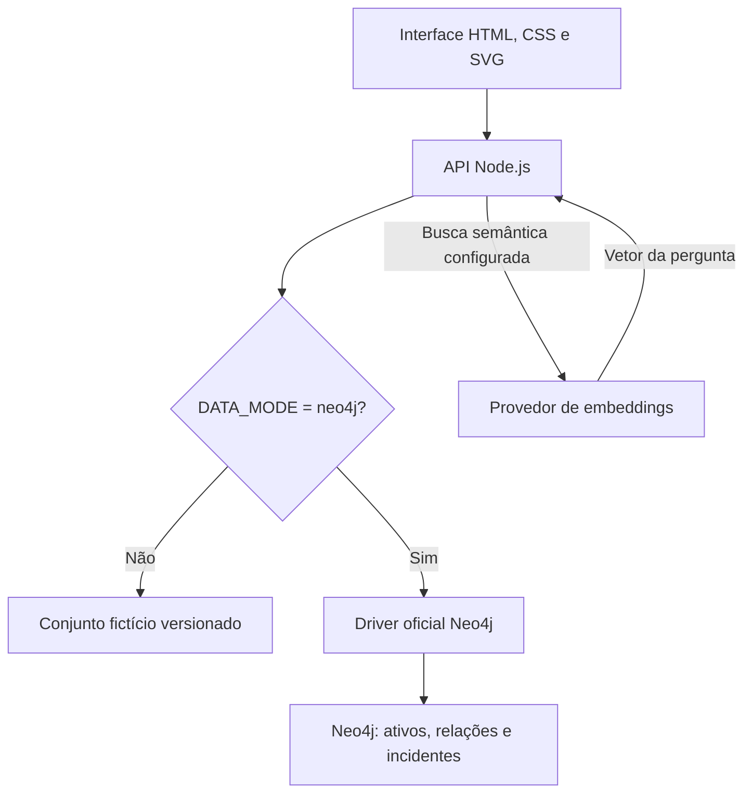
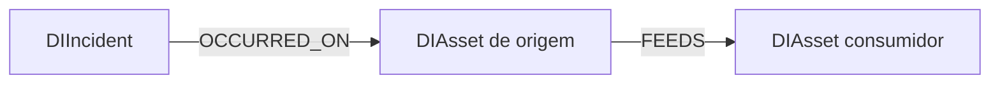

# Arquitetura e modelo de dados

[Voltar ao README](../README.md) · [Consultas Cypher](CYPHER.md) · [Instalação](INSTALLATION.md)

## Visão da execução

A aplicação contém duas rotas públicas de leitura. Há três modos: `demo` para dados fictícios, `file` para catálogo JSON próprio e `neo4j` para persistência em grafo. Valores desconhecidos são recusados. Se o banco falhar, a API retorna erro. Ela não substitui silenciosamente o resultado por um conjunto local.

O HTML autônomo é um formato de distribuição da demonstração, gerado por `scripts/build-preview.js`. Ele incorpora dados e lógica, sem usar API ou Neo4j. É útil para avaliar a experiência, mas não comprova integração com o banco.

## Modelo persistido

`FEEDS` significa **“fornece dados para”**. Logo, a jusante segue a seta e a montante percorre a relação no sentido inverso. A relação registra dependência; não representa causalidade confirmada de um incidente.

### Nós

| Label | Propriedade | Tipo esperado na carga | Finalidade |
| --- | --- | --- | --- |
| `DIAsset` | `id` | String | Identificador estável com constraint de unicidade |
| `DIAsset` | `label` | String | Nome apresentado ao usuário |
| `DIAsset` | `kind` | String | `source`, `job`, `table` ou `report` |
| `DIAsset` | `owner` | String | Equipe responsável |
| `DIAsset` | `description` | String | Contexto do ativo |
| `DIIncident` | `id` | String | Identificador único da ocorrência |
| `DIIncident` | `title`, `description` | String | Texto para consulta e embedding |
| `DIIncident` | `asset` | String | ID do ativo, mantido também para navegação na API |
| `DIIncident` | `evidence`, `resolution` | String | Evidência fictícia e solução histórica |
| `DIIncident` | `tags` | Lista de strings | Termos adicionais para busca lexical |
| `DIIncident` | `embedding` | Lista numérica opcional | Vetor de 1.536 dimensões |

As constraints garantem unicidade de `id`. Os demais tipos e a obrigatoriedade das propriedades são convenções da carga, sem constraints de existência ou tipo nesta versão.

### Relações e cardinalidade do conjunto

| Elemento | Quantidade |
| --- | ---: |
| Fontes | 4 |
| Processos | 9 |
| Tabelas | 9 |
| Relatórios | 6 |
| Incidentes | 4 |
| `FEEDS` | 28 |
| `OCCURRED_ON` | 4 |

A API do grafo retorna somente `FEEDS`. Os incidentes são retornados separadamente. `OCCURRED_ON` está persistida e pode ser explorada em Cypher, mas a interface navega usando a propriedade `asset` do incidente.

## Decisões de modelagem

**Label comum e categoria em propriedade.** `DIAsset` permite representar o catálogo com um contrato uniforme. Labels adicionais por tipo seriam uma evolução possível para consultas e restrições especializadas.

**Responsável como propriedade.** Uma string atende ao conjunto pequeno. Quando equipes tiverem relações, pessoas, escalas ou substituições, nós próprios e relações de responsabilidade passam a agregar valor.

**Incidente como entidade.** A ocorrência mantém seu texto, evidência e solução separados do ativo. Assim, múltiplos incidentes podem se referir ao mesmo ativo sem sobrescrever sua identidade.

**Carga idempotente para o mesmo conjunto.** `MERGE` por ID e por relação evita duplicar o seed ao repetir a execução. Não é uma sincronização completa: remover ou mudar uma relação no arquivo de origem não remove a relação antiga do banco.

## Travessia e explicação

A função de travessia usa busca em largura e um conjunto de visitados. O primeiro caminho encontrado tem o menor número de relações no grafo carregado; quando há empate, a escolha depende da ordem de leitura das relações. Não há pesos, custo ou priorização de criticidade.

A implementação examina todas as relações para cada nó visitado: o custo dominante é `O(V × E)`, além da cópia dos caminhos. Ela não usa lista de adjacência, portanto não se deve atribuir a ela a complexidade `O(V + E)` de uma BFS otimizada. Os visitados impedem laços em grafos cíclicos.

A API recusa conjuntos com mais de 500 ativos, 2.000 relações ou 200 incidentes. Essas barreiras são limites da demonstração, não resultados de capacidade ou SLA. A evolução de escala exige expansão seletiva no servidor, paginação, limites de profundidade e medição do plano de execução.

A lógica está em `lib/graph.js` e em sua cópia para o navegador `public/graph.js`. Mudanças futuras devem manter ambas sincronizadas ou introduzir um build que gere a cópia.

## Contratos HTTP

| Rota | Entrada | Resposta de sucesso | Erros previstos |
| --- | --- | --- | --- |
| `GET /api/graph` | Sem parâmetros | `nodes`, `edges`, `incidents`, `mode`, `issues`, `evaluatedAt` | 503 para falha de consulta ou limite do grafo |
| `GET /api/search?q=...` | Texto de 3 a 300 caracteres após trim | `mode`, `items` | 400 para texto inválido; 503 para falha de busca |
| Ambas | Método diferente de GET | — | 405 |

As respostas usam `Cache-Control: no-store`. Propriedades de embedding são removidas das projeções dos incidentes. IDs de ativos não são enviados como Cypher arbitrário; as consultas com parâmetros usam os mecanismos do driver.

## Recuperação de incidentes

**Lexical:** normaliza acentos e caixa, ignora tokens com até dois caracteres e conta quantos termos da consulta aparecem como substring no título, descrição ou tags. Não é BM25; não há análise morfológica, sinônimos, calibração ou probabilidade.

**Vetorial:** a carga opcional consulta os incidentes do Neo4j e envia seus títulos e descrições ao provedor, grava vetores e cria índice de cosseno. A consulta gera um vetor com o mesmo modelo e dimensão e pede os quatro vizinhos mais próximos ao Neo4j. Não há limiar mínimo de relevância nem reranking; com apenas quatro incidentes, a recuperação pode devolver todo o histórico. O score não é apresentado como confiança de causa.

A implementação usa `db.index.vector.queryNodes`. A documentação oficial marca essa procedure como depreciada a partir de Neo4j 2026.04 e recomenda `SEARCH` nas versões compatíveis. A migração é uma evolução pendente; confirme a versão e o suporte da instância antes de ativar a busca. Consulte a [referência oficial](https://neo4j.com/docs/cypher-manual/current/indexes/search-indexes/vector-indexes/).

## Operação e segurança

O driver é reutilizado, com pool máximo de 5 conexões, timeout de conexão de 8 segundos e timeout transacional de 10 segundos. A leitura usa roteamento `READ`, mas isso não substitui permissões no banco: use credenciais com privilégio de leitura na aplicação e credencial separada para carga/índices.

A API não implementa autenticação, autorização por ativo ou rate limit. O conjunto público deve permanecer fictício. Uma chave de embeddings em uma API pública permite consumo pelo público; não publique essa modalidade amplamente antes de adicionar controles de uso e custo.

Não há logs de auditoria, histórico de alterações de linhagem nem métricas de operação nesta versão. Não foi realizado teste integrado com instância Neo4j ou provedor de embeddings no ambiente de desenvolvimento desta entrega.

## Ingestão e verificações

O [guia de dados próprios](DATA_SOURCES.md) descreve os contratos. `lib/catalog.js` valida IDs, referências, tipos e limites. `lib/checks.js` avalia volume e atualização e anexa os caminhos de impacto a cada violação. As regras ficam em propriedades do ativo, sem um motor de expressão arbitrária.

O modo arquivo lê um snapshot local, e o importador Neo4j faz upsert transacional. A coleta PostgreSQL ocorre em um processo administrativo separado, com uma transação somente leitura; arquivos de dados são perfilados localmente. Não há endpoint público de importação. A descoberta PostgreSQL cobre relações de views entre objetos selecionados; não cria linhagem de ferramentas externas.

Alertas são calculados no carregamento e não são persistidos como incidentes históricos. Não há agendamento nem SLA de idade da coleta. O timestamp de observação acompanha a métrica; os detalhes operacionais e limites estão documentados no guia de conexão.
