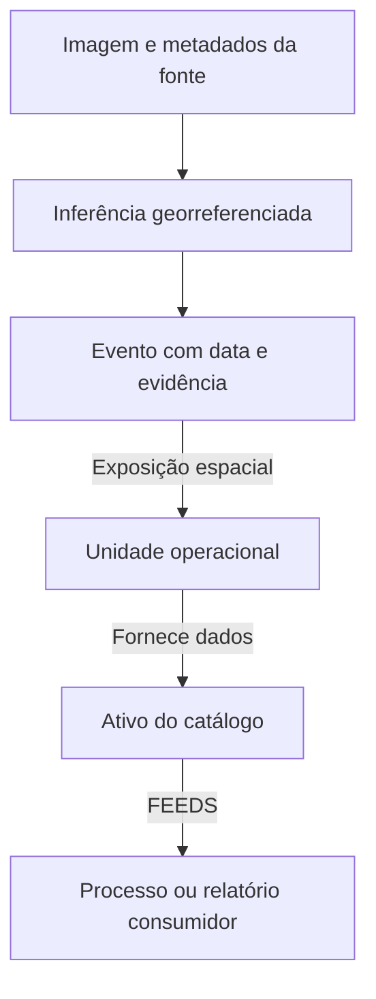

# Extensão geoespacial e GeoAI

[Voltar ao README](../README.md)

**Estado: proposta de evolução.** O código atual não processa imagens de satélite, geometrias ou modelos GeoAI. Este documento define um caso de uso e os componentes necessários para uma implementação futura; não descreve uma capacidade já entregue.

## Caso de uso proposto

Relacionar eventos territoriais a ativos operacionais e às dependências que eles sustentam. Por exemplo: identificar quais unidades, fornecedores ou infraestruturas estão próximas de uma ocorrência de inundação e quais produtos de dados dependem dessas unidades.

A localização responde “onde existe exposição?”. O grafo responde “quais dependências podem ser afetadas?”. Um modelo GeoAI, quando implementado e validado, pode fornecer detecções georreferenciadas a partir de imagens. Essas três etapas precisam manter evidências e incertezas separadas.

## Componentes e fronteiras

| Componente proposto | Responsabilidade | O que não comprova |
| --- | --- | --- |
| Ingestão espacial | Receber pontos, polígonos e metadados com CRS e data | Veracidade ou atualidade do evento |
| Processamento GIS | Calcular proximidade ou interseção | Previsão de dano ou causalidade |
| Inferência GeoAI | Estimar uma classe ou segmentação georreferenciada | Confirmação de uma ocorrência sem validação |
| Neo4j | Relacionar eventos, ativos, evidências e consumidores | Acurácia do modelo de visão |
| Interface | Mapa com camadas e caminhos no grafo | Resolução maior que a fonte de imagem |

## Modelo proposto

Guardar fonte, horário de aquisição, versão do modelo, classe, score, geometria, CRS e data de inferência. Um score deve ser interpretado segundo a calibração do modelo, e não como probabilidade genérica de risco operacional.

## Papel do Neo4j e do GIS

O Neo4j possui valores `POINT` e funções espaciais para consultas de distância. Para interseção de polígonos, reprojeção e processamento raster, planeje um componente GIS, como PostGIS ou bibliotecas geoespaciais apropriadas. A existência de um índice espacial não transforma operações de distância em inferência de IA.

Na proposta, o Neo4j armazenaria relações e referências à evidência. Imagens raster ficariam em armazenamento apropriado, com metadados de catálogo. STAC oferece um formato padronizado para descrever e localizar ativos espaço-temporais.

## Qualidade visual e qualidade científica

Uma imagem de satélite visualmente nítida pode ter resolução espacial insuficiente para o objeto de interesse. Registre o tamanho do pixel, bandas, resolução temporal, nível de processamento, CRS, nuvens e licença. Ampliar ou aplicar super-resolução não cria observações novas e não deve ser usado para afirmar detalhes que a fonte não mede.

Imagens geradas para uma capa não devem aparecer como evidência geográfica real. Uma detecção deve apontar para a cena original, sua data e a geometria usada na análise.

## Critérios antes de anunciar GeoAI como funcionalidade

1. Implementar ingestão com CRS explícito e testes de coordenadas e ordem longitude/latitude.
2. Validar uma camada espacial por regras antes de adicionar um modelo.
3. Selecionar imagens e rótulos adequados à tarefa.
4. Separar treino e teste espacial e temporalmente para reduzir vazamento.
5. Reportar métricas apropriadas, como precisão/recall para detecção e IoU para segmentação, por região e classe.
6. Conectar resultados ao grafo com proveniência e apresentar a incerteza na interface.
7. Reproduzir a execução com fonte, parâmetros, versão do modelo e limites conhecidos.

## Referências

- [Neo4j: valores espaciais](https://neo4j.com/docs/cypher-manual/current/values-and-types/spatial/)
- [STAC Specification](https://stacspec.org/en/about/stac-spec/)
- [Copernicus Data Space: catálogo STAC](https://documentation.dataspace.copernicus.eu/APIs/STAC.html)
